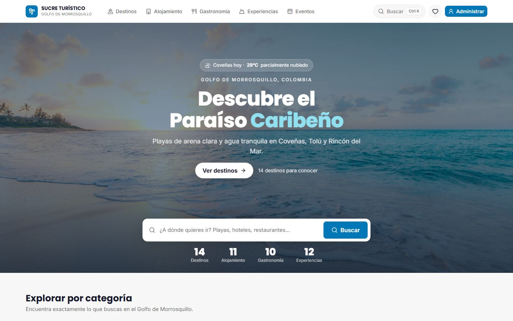
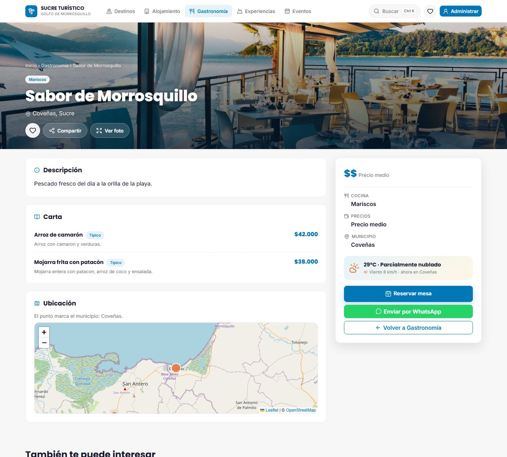
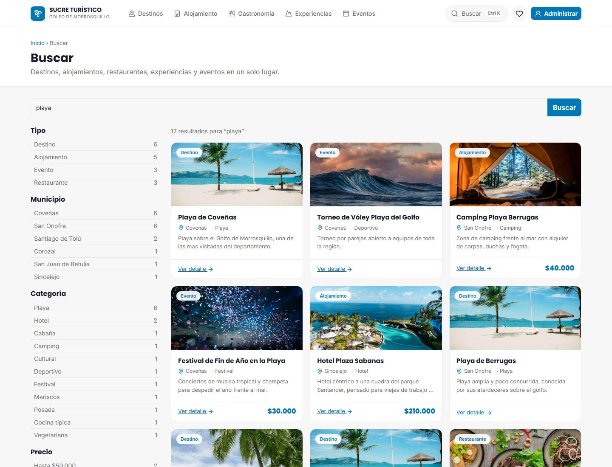
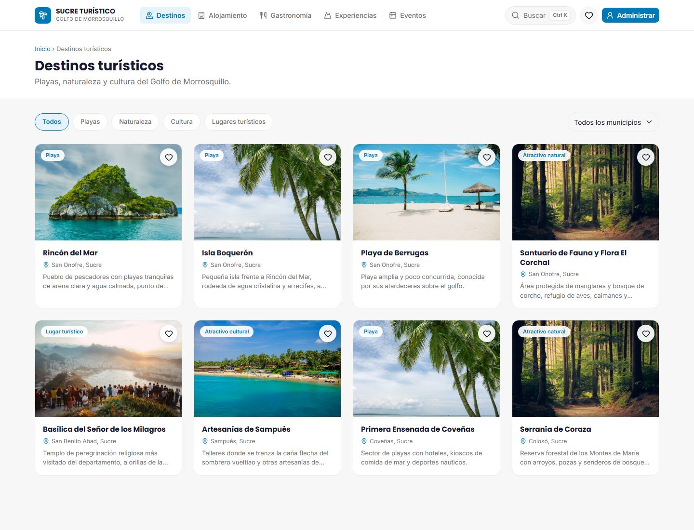
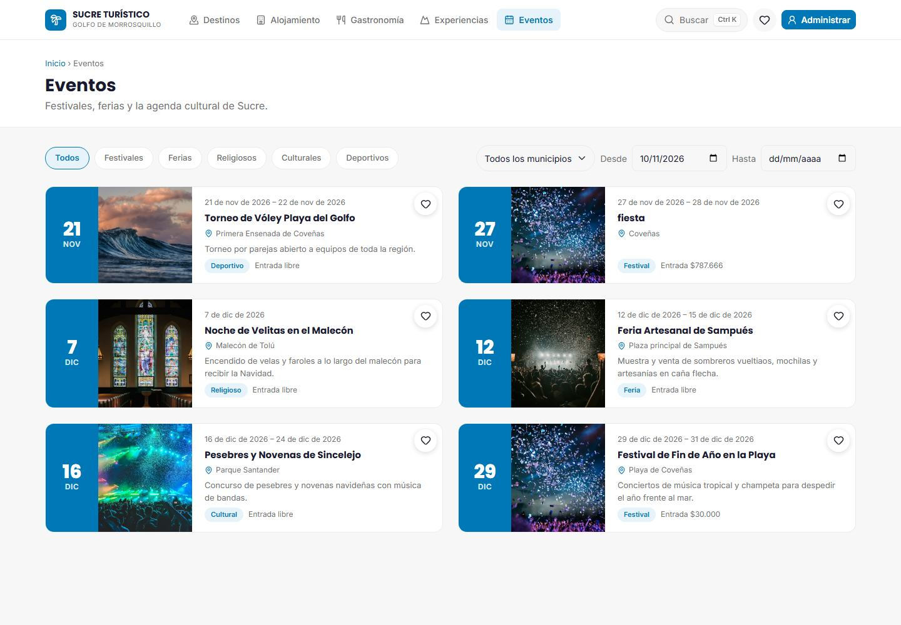
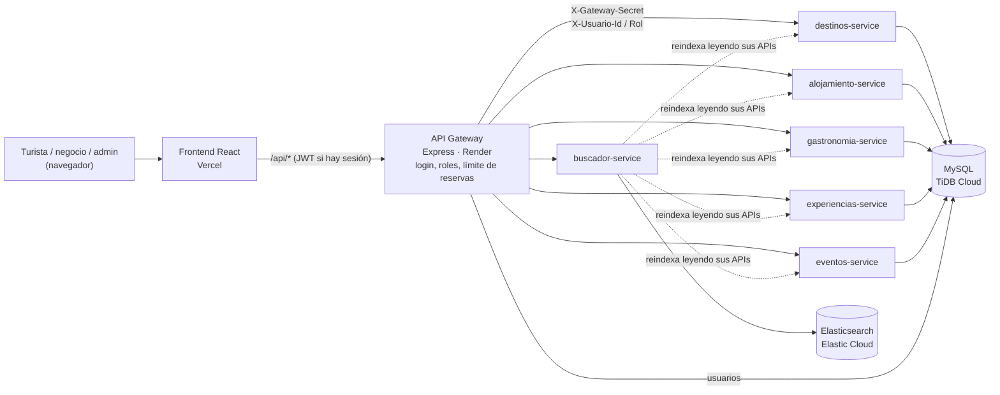

# Sucre Turístico

Plataforma Web Full Stack para la Promoción y Gestión Turística del Golfo de Morrosquillo.
Proyecto Integrador — Electiva II, Corporación Universitaria Antonio José de Sucre (UNIAJS).

## En producción

| | URL |
|---|---|
| Aplicación | https://sucre-turistico-frontend.vercel.app |
| API Gateway | https://sucre-turistico.onrender.com/health |
| Panel de administración | https://sucre-turistico-frontend.vercel.app/admin |

Antes de una demo: `node scripts/probar-produccion.js` comprueba todo en ~1 minuto (25 pruebas) y deja los servicios despiertos (los gratis de Render se duermen tras 15 min).



## Qué hace

**Para el turista** (sin crear cuenta):

- **Cinco catálogos** —destinos, alojamiento, gastronomía, experiencias y eventos— con filtros por municipio, tipo y precio.
- **Página de detalle** de cada lugar: foto a pantalla completa, ficha con precio y datos clave, **clima en vivo** del municipio, **mapa** (OpenStreetMap), carta de **platos típicos** en los restaurantes y un carrusel de lugares relacionados.
- **Reservas** de alojamiento, mesa o experiencia desde la ficha: el negocio recibe la solicitud y contacta al turista.
- **Buscador avanzado** con Elasticsearch: texto libre sin importar tildes, autocompletado y **facets** (tipo, municipio, categoría, precio).
- **Buscador instantáneo** (`Ctrl+K`), **favoritos** guardados en el navegador, compartir y WhatsApp.
- Diseño de aplicación: portada con vistas que cambian solas, barra inferior en el celular, animaciones suaves.

**Para los negocios y el administrador** ([`docs/AUTENTICACION.md`](docs/AUTENTICACION.md)):

| Rol | Qué maneja |
|---|---|
| **Superadministrador** | Todo el catálogo, incluidos los destinos turísticos, y las cuentas de los negocios: crearlas con contraseña temporal, suspenderlas, restablecerlas, asignarles fichas. Ve todas las reservas. |
| **Negocio** (hotel, restaurante, operador) | Solo sus fichas: las crea, edita, publica u oculta, maneja la carta de su restaurante y atiende la bandeja de **reservas** (confirmar, rechazar, escribir por WhatsApp). |

| Detalle de un lugar | Buscador con facets |
|---|---|
|  |  |

| Destinos | Agenda de eventos |
|---|---|
|  |  |

## Equipo

| Nombre    | Rol           |
|-----------|---------------|
| Sebastián | Scrum Master  |
| Halit     | Equipo de desarrollo |
| Jaime     | Equipo de desarrollo |
| Wilinton  | Equipo de desarrollo |

## Documentos del proyecto

- [`docs/BACKLOG.md`](docs/BACKLOG.md) — historias de usuario del producto.
- [`docs/SPRINT_PLAN.md`](docs/SPRINT_PLAN.md) — planificación de sprints y asignación de trabajo.
- [`docs/CLICKUP_SETUP.md`](docs/CLICKUP_SETUP.md) — guía paso a paso para montar el tablero en ClickUp.
- [`docs/DEPLOYMENT.md`](docs/DEPLOYMENT.md) — cómo conectar Vercel/Render/Elastic Cloud y despliegues por rama (preview).
- [`docs/AUTENTICACION.md`](docs/AUTENTICACION.md) — roles (superadmin y negocio), login con JWT, permisos por dueño y reservas.
- [`docs/VIDEOMEMORIA.md`](docs/VIDEOMEMORIA.md) — guion de la videomemoria, con quién presenta cada parte.
- [`docs/DESARROLLO_LOCAL.md`](docs/DESARROLLO_LOCAL.md) — **empieza por aquí**: las dos formas de correr el proyecto (con y sin Docker) y los problemas conocidos.
- [`docs/GUIA_CRUD_PASO_A_PASO.md`](docs/GUIA_CRUD_PASO_A_PASO.md) — tutorial para implementar el CRUD de un microservicio contra MySQL, de principio a fin.
- [`CONTRIBUTING.md`](CONTRIBUTING.md) — flujo de Git, convención de commits y proceso de Pull Request.

## Arquitectura



- Todo pasa por el **API Gateway**: el frontend nunca llama a un microservicio directo. El gateway valida el token, revisa la cuenta en cada escritura y le dice al servicio quién pregunta; cada microservicio solo acepta escrituras que traigan el secreto del gateway y aplica los permisos de dueño ([`docs/AUTENTICACION.md`](docs/AUTENTICACION.md)).
- Cada microservicio es dueño de su parte del catálogo; el buscador no lee la base de los demás, sino sus APIs.

- **Front-End:** React 19 + Vite (JavaScript ES6+, Bootstrap con React Bootstrap, React Router, Axios), más lucide-react, motion, Swiper, react-leaflet, cmdk y sonner para el acabado (ver [`frontend/README.md`](frontend/README.md)).
- **Back-End:** Node.js + Express, arquitectura de microservicios detrás de un API Gateway.
- **Microservicios:** `destinos`, `alojamiento`, `gastronomia`, `experiencias`, `eventos`, `buscador`.
- **Bases de datos:** MySQL (datos estructurados), Elasticsearch (búsqueda full-text, facets, sugerencias).
- **Contenerización:** Docker + Docker Compose.
- **Despliegue:** Front-end en Vercel, back-end en Render, MySQL en TiDB Cloud y Elasticsearch en Elastic Cloud Serverless.

## Estructura del repositorio

```
sucre-turistico/
├── frontend/                  # App React
├── api-gateway/                # Express API Gateway
├── services/
│   ├── destinos-service/
│   ├── alojamiento-service/
│   ├── gastronomia-service/
│   ├── experiencias-service/
│   ├── eventos-service/
│   └── buscador-service/       # Integración con Elasticsearch
├── docs/
├── .github/workflows/          # Pipelines de CI/CD
└── docker-compose.yml
```

## Quickstart (clonar y arrancar)

Requisitos: **Node.js 20.19+ o 22+** (Vite 8 no corre con Node 18), **Git**, y **Docker Desktop** según la ruta que uses.

> **Antes de arrancar, mira cuánta RAM tiene tu equipo.** Con **6 GB o menos, `npm run up` no te va a funcionar**: el stack completo pide ~4.3 GB y Docker se cae. En ese caso usa la ruta ligera (sin Docker, 625 MB) que está en [`docs/DESARROLLO_LOCAL.md`](docs/DESARROLLO_LOCAL.md). No pierdas una tarde creyendo que hiciste algo mal.

```bash
git clone https://github.com/sebastianmarinc19-sudo/sucre-turistico.git
cd sucre-turistico
git checkout develop

npm install        # instala dependencias de api-gateway y todos los services (npm workspaces)
npm run setup      # crea los .env de cada servicio a partir de sus .env.example

npm run up         # equivalente a: docker compose up --build
```

Si algo falla, [`docs/DESARROLLO_LOCAL.md`](docs/DESARROLLO_LOCAL.md) tiene una sección de problemas conocidos con los errores que ya nos salieron montando esto.

- Front-end: http://localhost:3000 (ver [`frontend/README.md`](frontend/README.md))
- API Gateway: http://localhost:4000/health
- Cada microservicio: http://localhost:400X/health (`destinos`=4001, `alojamiento`=4002, `gastronomia`=4003, `experiencias`=4004, `eventos`=4005, `buscador`=4006)
- Elasticsearch: http://localhost:9200

Para bajar los contenedores: `npm run down`. Para ver logs: `npm run logs`.

## Trabajar en tu rama

```bash
git checkout develop
git pull
git checkout -b feature/<microservicio>-<tarea>
# ... programar ...
git push origin feature/<microservicio>-<tarea>
```

Abrir el Pull Request contra `develop` en GitHub. Una vez configurado Vercel/Render (ver [`docs/DEPLOYMENT.md`](docs/DEPLOYMENT.md)), cada rama/PR genera automáticamente su propia URL de preview para probar sin afectar a los demás.

Ver [`CONTRIBUTING.md`](CONTRIBUTING.md) para la convención de commits y el proceso de revisión antes de empezar a programar.
