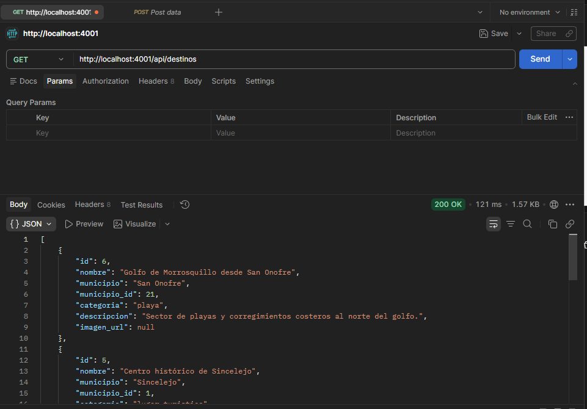
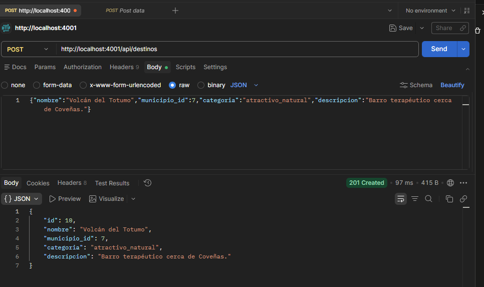
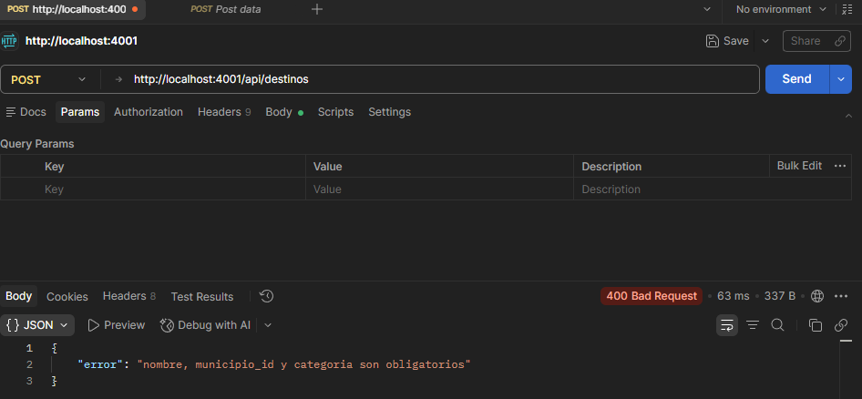
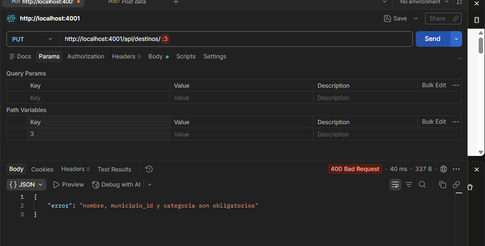
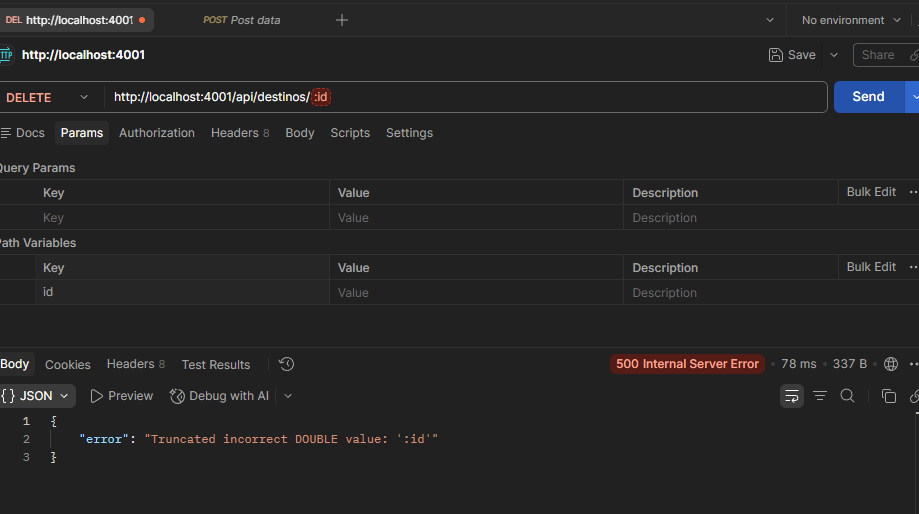

# Evidencias de prueba — Postman (destinos-service, puerto 4001)

Pruebas manuales realizadas sobre el microservicio `destinos-service` corriendo en
`http://localhost:4001`, con MySQL levantado en Docker y datos reales de
`docs/sql/04-datos-ejemplo.sql`.

> **Nota:** estas capturas son anteriores a `GATEWAY_SECRET`. Hoy un `POST`,
> `PUT` o `DELETE` directo al microservicio responde `403` si no lleva la
> cabecera `X-Gateway-Secret`; para repetirlas en local, agréguenla en Postman
> con el valor de `docker-compose.yml`, o hagan las escrituras por el gateway
> (`localhost:4000`) con token. Ver [`DEPLOYMENT.md`](../../DEPLOYMENT.md).

## 1. GET /api/destinos — 200 OK

Listado de destinos con JOIN a `municipios`. Confirma que los acentos y eñes se
guardan y devuelven correctamente (fix de codificación `SET NAMES utf8mb4` en
las semillas SQL).

## 2. POST /api/destinos — 201 Created

Creación de un destino nuevo ("Volcán del Totumo", id `10`). Confirma que el
`INSERT` funciona y que el servicio devuelve el registro creado con su `id`.

## 3. POST /api/destinos — 400 Bad Request (validación)

Envío sin body: el servicio detecta los campos obligatorios faltantes
(`nombre`, `municipio_id`, `categoria`) y responde `400` con un mensaje claro,
en vez de fallar de forma genérica. Evidencia de manejo de errores.

## 4. PUT /api/destinos/:id — 400 Bad Request (validación)

Mismo caso que el anterior aplicado a la actualización: sin body, el servicio
responde `400` en vez de guardar datos vacíos.

## 5. DELETE /api/destinos/:id — 500 (id inválido)

Caso con el path variable sin resolver (`:id` literal en vez de un id
numérico): MySQL rechaza el valor y el servicio lo propaga como error
controlado, sin caerse.

---

## CRUD completo (create/read/update/delete) de los 3 microservicios

Las operaciones de actualización y eliminación **exitosas** (`PUT` → 200,
`DELETE` → 204) para los 3 microservicios requeridos (`destinos`,
`alojamiento`, `gastronomia`), incluyendo el paso a través del API Gateway con
protección por token de administrador, quedan documentadas de forma
automatizada y reproducible en
[`docs/evidencias/evidencia-crud.html`](../evidencia-crud.html): una página
que ejecuta las 4 operaciones contra los 3 servicios en vivo y muestra
método, URL, código HTTP y respuesta de cada llamada.

Esta combinación (Postman + página de evidencia automatizada) cumple el
requisito de la Entrega 1: *"Pruebas mediante Postman, Thunder Client u otra
herramienta"* (sección 1.10 del PDF de la actividad).
